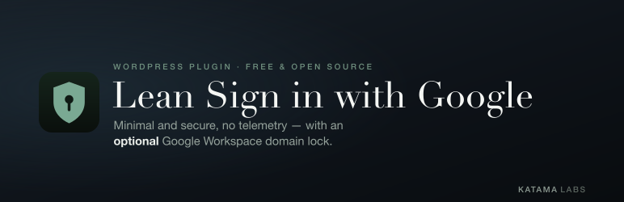

<p align="center">
  
</p>

# Lean Sign in with Google

[](https://github.com/katamalabs/lean-sign-in-with-google/actions/workflows/pull-requests.yml)
[](LICENSE)

A small WordPress plugin that adds a **Sign in with Google** button to the login screen, with an optional Google Workspace domain allow-list. Free, no upsells, no telemetry. A deliberately minimal, secure sibling to [Lean SMTP](https://github.com/katamalabs/lean-smtp).

Password login is never disabled — the plugin only *adds* a button, so you can't be locked out.

## Features

- **Sign in with Google** button on `wp-login.php` using the OAuth2 **authorization-code** flow (server-side; no client-side JavaScript, no bundled Google SDK).
- **Domain allow-list** (optional): restrict sign-in to one or more Google Workspace domains, matched against the verified email domain and the Workspace `hd` claim.
- **Existing-user sign-in** by verified email. Creating accounts for new Google users is an explicit opt-in, with a role you choose.
- **Account linking**: the Google account id (`sub`) is linked to the WordPress user on first sign-in, so a later login to the same email must come from the same Google account.
- **Encrypted secrets**: the OAuth client secret is AES-256 encrypted at rest, keyed to your site salts, and never echoed back to the browser.
- **wp-config.php overrides** for the client ID, secret, and allowed domains.

## Why only `openid email profile`

Login needs only the **non-sensitive** `openid`, `email`, and `profile` scopes. Unlike Google's restricted scopes, these require **no app verification** and work with an External *or* Internal consent screen, Workspace or consumer. Because the identity token is read straight from Google's TLS response during the code exchange, no JWT signature verification is needed — one reason this ships only the redirect flow and not One Tap.

## How it works

- The id_token is trusted **only** as read from the authorization-code exchange (Google's TLS response), never from the browser.
- CSRF is defended by a random `state` bound to the browser with a short-lived, HttpOnly, SameSite=Lax cookie and verified with `hash_equals`.
- A verified email (`email_verified`) is required; the domain allow-list is enforced on both sign-in and auto-creation.
- The Google `sub` is linked to the WordPress user to block email-reassignment account takeover.

## Setup

1. In the [Google Cloud Console](https://console.cloud.google.com/), create an OAuth 2.0 Client ID of type **Web application**.
2. In **Settings → Lean Sign in with Google**, copy the shown **Authorized redirect URI** into your OAuth client's redirect URIs (exact match).
3. Paste the **Client ID** and **Client Secret**, save.
4. Optionally set **Allowed domains** and the **new-user** behaviour.

## Configuring in wp-config.php

The client ID, secret, and allowed domains can each be a constant instead of a stored option. The constant always wins, and secrets defined this way are used as-is and never written to the database.

```php
define( 'LEAN_GOOGLE_LOGIN_CLIENT_ID', getenv( 'GOOGLE_CLIENT_ID' ) );
define( 'LEAN_GOOGLE_LOGIN_CLIENT_SECRET', getenv( 'GOOGLE_CLIENT_SECRET' ) );
define( 'LEAN_GOOGLE_LOGIN_ALLOWED_DOMAINS', 'example.com' );
```

## Development

```bash
make dev    # docker compose dev site at http://localhost:8083
make lint   # phpcs, WordPress-Core standard (tabs, snake_case)
make fmt    # phpcbf auto-fix
make test   # phpunit in Docker
make build  # git archive -> build/lean-sign-in-with-google.zip
```

Run a single test: `docker compose -f docker-compose.test.yml run --rm test --filter test_name`.

## License

GPL-2.0-or-later. See [LICENSE](LICENSE).
